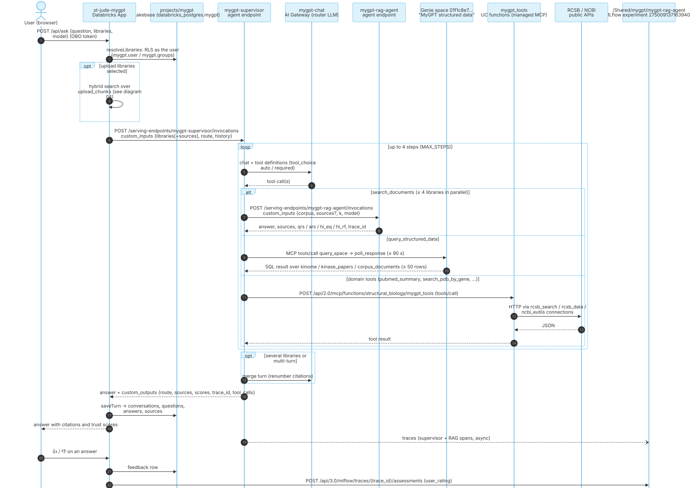
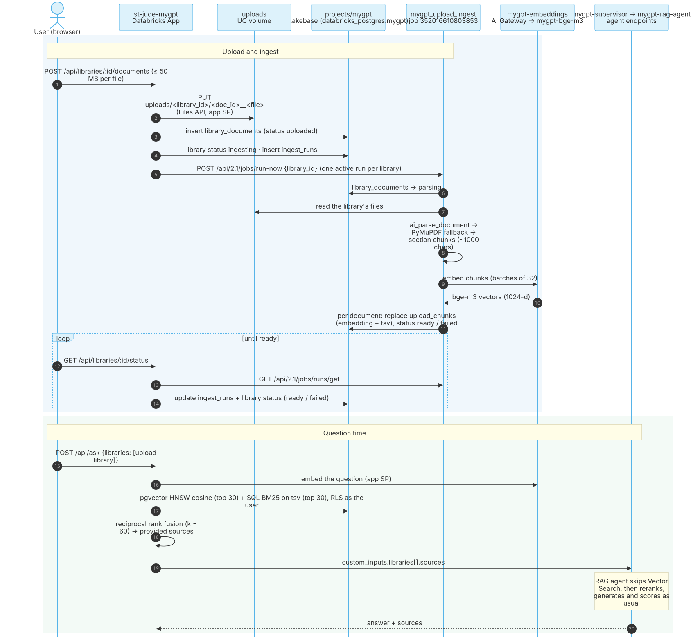

# MyGPT architecture

How MyGPT's components talk to each other, one diagram per flow. Every box uses the deployed name or ID from **[INVENTORY.md](INVENTORY.md)**, so each one maps to a live resource.

| # | Diagram | Shows |
|---|---|---|
| 00 | [Overview](#00-overview) | Every major component on one page |
| 01 | [ETL](#01-etl-corpus-ingestion-and-the-vector-index) | Corpus PDFs → section chunks → `doc_chunks_corpus_index` |
| 02a | [Agent use](#02a-agent-use-a-grounded-question) | A grounded question: app → Supervisor → RAG agent / Genie / tools |
| 02b | [RAG pipeline](#02b-inside-mygpt-rag-agent) | The steps inside `mygpt-rag-agent` |
| 03 | [Data architecture](#03-data-architecture) | Volumes, tables, indexes, Lakebase, MLflow, and what feeds what |
| 04 | [Upload libraries](#04-upload-libraries) | A user's own documents → Lakebase → question-time hybrid search |
| 05 | [Evaluation & monitoring](#05-evaluation-and-monitoring) | Eval datasets → eval jobs → judges → experiment → dashboards |
| 06 | [Model & gateway routing](#06-model-and-gateway-routing) | Every model call: gateway vs direct, identities, telemetry |

**Sources.** The Mermaid sources are in `docs/diagrams/*.mmd`. Run `make diagrams` (or `docs/diagrams/render.sh [name]`) to regenerate the committed `.svg` and `.png` files after editing one. The script uses mermaid-cli via `npx` and a local Chrome. PNGs are rendered at 2× for slides.

**Legend** (the same in every flowchart; fill / border colours from `docs/diagrams/_classes.mmd`):

| Resource type | Shape · colour | Resource type | Shape · colour |
|---|---|---|---|
| UC volume | cylinder · blue `#E3F0FA` / `#0072B2` | Serving endpoint (custom / agent) | box · blue, bold border `#CFE4F7` / `#0058A3` |
| UC table / view | box · green `#E2F4EC` / `#009E73` | AI Gateway endpoint | box · orange `#FBE0D1` / `#D55E00` |
| Vector Search index | hexagon · amber `#FFF1D1` / `#E69F00` | FMAPI pay-per-token model | box · yellow `#FFF8C4` / `#A89400` |
| UC function / connection / Genie | box · pink `#F9E6F0` / `#CC79A7` | Job / task | box · grey `#EDEDED` / `#555555` |
| Lakebase | box or cylinder · purple `#EFE3F6` / `#7E3F98` | App / dashboard | box · light blue `#DDF2FB` / `#56B4E9` |
| MLflow (experiment, UC models) | box · teal `#DCF3F0` / `#00897B` | External service / system tables | dashed outline |

Dashed edges are optional, fallback or not-yet-configured paths.

---

## 00 Overview

Source: [00-overview.mmd](docs/diagrams/00-overview.mmd)

- Users only reach **`st-jude-mygpt`**. A grounded question goes to **`mygpt-supervisor`**, which delegates to **`mygpt-rag-agent`** (documents), the **Genie space** (structured data) and the **`mygpt_tools`** UC functions (PubMed / PDB).
- The models sit behind three AI Gateway endpoints: `mygpt-chat`, `mygpt-translate` and `mygpt-embeddings`. Some calls go straight to FMAPI instead (diagram 06).
- Two ingest paths: **`mygpt_etl`** builds the governed corpus in UC and Vector Search. **`mygpt_upload_ingest`** indexes users' upload libraries into **Lakebase**.
- Both agents trace to one MLflow experiment, which the eval jobs and the two dashboards read.

## 01 ETL: corpus ingestion and the vector index

Source: [01-etl.mmd](docs/diagrams/01-etl.mmd) · Code: `etl/sql/*.sql`, `etl/parse_fallback.py`, `etl/sync_index.py`, `etl/structured_seed.py` · Job: `databricks.yml` → `mygpt_etl`

1. **`landing`** rebuilds `documents`, a FILE EXTERNAL table of pointers into the `docs` volume. Each top-level folder is a corpus (`biomed`, `health_policies_fr/es/hi`, `kinase_literature`).
2. **`parse_chunk_index`** runs `ai_parse_document` only on new or changed files, tracked by size and mtime in `doc_parse_log`. It writes the elements to `_doc_elements_stage`.
3. **`parse_fallback`** re-extracts garbled or script-less documents with PyMuPDF and records them in `doc_parse_quality`. It does nothing when no document is flagged.
4. **`chunk_merge`** builds about 1000-character section-bounded chunks and MERGEs them into **`doc_chunks`** on a stable `chunk_id`, so unchanged chunks produce no change-feed rows. It also rebuilds `paper_sections`.
5. Three branches then run in parallel:
   - **`sections_and_config`** seeds the scoring config tables.
   - **`sync_index`** syncs the TRIGGERED **`doc_chunks_corpus_index`** and waits for the row count to match. It creates the index on its first run.
   - **`structured_seed`** writes the Genie tables from the `reference` CSVs.

Notes:
- The SQL tasks run on warehouse `79388385e899d08b`; the Python tasks are serverless.
- The index embeds through **`mygpt-bge-m3` directly**, at sync time and at query time. Vector Search can't use an AI Gateway endpoint, which is why bge-m3 must never scale to zero.
- **`doc_chunks_index`** is the Phase-1 index. It still syncs from `doc_chunks` but nothing queries it: a candidate for deletion.

## 02a Agent use: a grounded question

Source: [02a-agent-ask.mmd](docs/diagrams/02a-agent-ask.mmd) · Code: `app/server/routes/ask.ts`, `app/server/agent.ts`, `agents/supervisor/supervisor_agent.py`

- **Identity.** `/api/ask` runs on behalf of the user (OBO token from `x-forwarded-access-token`), with one exception: upload-library query embedding uses the app SP. Lakebase reads are row-level secured via `mygpt.user` / `mygpt.groups` (`app/server/db/context.ts`).
- **Routing.** The Supervisor runs at most 4 LLM steps with **`mygpt-chat`** as its router. `route=docs` skips the LLM and searches documents directly. `genie` / `tools` force the first tool call.
- **Documents.** `search_documents` calls `mygpt-rag-agent` once per library, up to 4 in parallel. With one library in a single turn, the RAG answer is returned verbatim. Otherwise a merge turn renumbers the citations.
- **Structured data.** Genie is called over managed MCP: `/api/2.0/mcp/genie/<space id>`, `query_space` then `poll_response`, for up to 90 s and 50 rows.
- **Domain tools.** The UC functions are discovered with MCP `tools/list` on `/api/2.0/mcp/functions/structural_biology/mygpt_tools`. They reach RCSB and NCBI only through the UC HTTP connections.
- **Persistence.** The app saves the turn (`questions`, `answers`, `sources`) after replying. Feedback writes a `feedback` row and a `user_rating` assessment on the answer's MLflow trace. The app relies on `trace_id`; its `MYGPT_EXPERIMENT_ID` setting is unused.
- **Direct chat** (not shown) streams from the browser through the AppKit serving plugin to FMAPI as the user. Nothing is persisted.

> Both agent endpoints currently keep every earlier model version served at 0% traffic (rag-agent: 3 versions; supervisor: 5), each on its own always-on compute. This is visible on the cost dashboard. Fixing the deploy drivers is a separate task.

## 02b Inside `mygpt-rag-agent`

Source: [02b-rag-pipeline.mmd](docs/diagrams/02b-rag-pipeline.mmd) · Code: `agents/rag_agent/agent.py` (`scoring.py`, `config.py`, `hi_random_forest.py` mirror its inlined logic) · Deploy: `agents/rag_agent/driver.py`

1. **Config.** Per-dataset coefficients, cutoffs and reranker thresholds. The deployed agent uses the **packaged defaults**: it reads the Delta config tables only if `MYGPT_WAREHOUSE_ID` is set, and the driver doesn't set it.
2. **Translate.** Non-English corpora translate the query through `mygpt-translate` when `translate_query` is on.
3. **Retrieve.** Either a HYBRID query on `doc_chunks_corpus_index`, filtered on `corpus` / `source_name` / `section` (default `k` = 5), or the upload-library sources passed in by the app, skipping Vector Search.
4. **Rerank.** In-process cross-encoders: `qnli-electra-base` for English, `mmarco-mMiniLMv2-L12-H384-v1` for other languages. Low-scoring sources are dropped, but never all of them.
5. **QRS.** A question-retrieval score from vector similarity, BM25 and rerank scores.
6. **Generate.** `model=sonnet`, the default, goes through **`mygpt-chat`** (the driver sets `MYGPT_LLM_SONNET`). `llama` and `gptoss` call FMAPI directly; they exist for the eval model matrix.
7. **Score the answer.** Answer embeddings via `mygpt-embeddings`, NLI (`nli-deberta-v3-base`, English only), ARS, and the hallucination index, both as an equation and from the packaged random forest.

The agent traces RETRIEVER and LLM spans to the shared experiment, and mirrors them to LangSmith when the `mygpt/langsmith_api_key` secret exists.

## 03 Data architecture

Source: [03-data.mmd](docs/diagrams/03-data.mmd)

- **`structural_biology.mygpt`** holds:
  - the four volumes: `docs` (governed corpus), `uploads` (user libraries), `reference` (MyGPT-evaluations CSVs), and `eval_private`, which is restricted to its owner because it holds the SME ground truths;
  - the corpus, config and Genie tables, the `eval_*` datasets, the UC models, and the inference tables.
- **`structural_biology.mygpt_tools`** holds only the five tool functions and the three HTTP connections they're allowed to call.
- **Lakebase** (`projects/mygpt`, branch `production`, endpoint `primary`, database `databricks_postgres`, schema `mygpt`) holds the app state:
  - upload libraries: `libraries` → `library_documents` → `upload_chunks` (pgvector HNSW + tsvector GIN), plus `ingest_runs`;
  - chat history: `conversations` → `questions` → `answers` → `sources` / `feedback`.
  - All nine tables have row-level security, and the app's SP owns the schema (`app/server/db/migrations.ts`).
- **MLflow** `/Shared/mygpt/mygpt-rag-agent` (`2750091371639406`) is the single experiment for LoggedModels, eval runs, production traces and assessments.
- **System tables** feed the two dashboards. Benchmarks reads `system.mlflow`. Costs reads `system.billing`, `system.serving`, `system.query`, `system.lakeflow` and `system.access`.

## 04 Upload libraries

Source: [04-upload-libraries.mmd](docs/diagrams/04-upload-libraries.mmd) · Code: `app/server/routes/libraries.ts`, `app/server/ingest.ts`, `app/server/volumes.ts`, `etl/upload_ingest.py`, `app/server/retrieval/lakebaseSearch.ts`, `app/server/retrieval/rrf.ts`

**Upload and ingest:**
- **Upload.** The app writes files to `uploads/<library_id>/<doc_id>__<file>` as its own SP, with a 50 MB cap and an extension whitelist. It then triggers `mygpt_upload_ingest` with `job_parameters.library_id`, allowing one active run per library.
- **Ingest** mirrors the corpus ETL: `ai_parse_document`, the PyMuPDF fallback (shared logic with `etl/parse_fallback.py`), and section chunks. It embeds through `mygpt-embeddings` and writes each document's chunks to `upload_chunks` in one transaction.
- **Status.** The job doesn't touch `ingest_runs`. The app updates it when the browser polls `/status`, which calls `jobs/runs/get`.

**Question time:**
- **Search.** The question is embedded once. The app runs a pgvector cosine search and an SQL Okapi BM25 search, top 30 each, scoped to the library, optional document and optional section, under the user's RLS. It fuses the two with RRF (k = 60).
- **Answer.** The hits go to the Supervisor as `custom_inputs.libraries[].sources`. The RAG agent skips Vector Search and reranks, generates and scores those sources as usual.

## 05 Evaluation and monitoring

Source: [05-eval-monitoring.mmd](docs/diagrams/05-eval-monitoring.mmd) · Code: `eval/build_datasets.py`, `eval/run_eval.py`, `eval/reference_baseline.py`, `eval/monitor.py`, `eval/scorers.py` · More: [eval/README.md](eval/README.md)

- **`mygpt_eval_build_datasets`** merges the MyGPT-evaluations questions and gold into five UC-backed eval datasets. The private gold comes from `eval_private`.
- **`mygpt_eval`** runs `mlflow.genai.evaluate` for each dataset × model, one at a time, against `mygpt-rag-agent`. It copies each request's trace into the eval run, scores with code scorers and the **`databricks-claude-opus-5-5`** judge, and applies `eval/gates.yaml` when `gate=true`. The judge must outrank the agent's model (`check_judge_outranks`).
- **`mygpt_eval_reference`** runs the same scorers on MyGPT's recorded answers, giving the parity baseline and judge-vs-SME agreement.
- **Production monitoring.** `mygpt_eval_monitor` registers sampled online scorers (Safety, RelevanceToQuery, RetrievalGroundedness). MLflow runs them in its own **Trace Metrics Computation Job** (`488240277362123`), MyGPT's most expensive job.
- **Dashboards.** The benchmarks dashboard reads the eval runs straight from `system.mlflow`, so it needs no ETL.

## 06 Model and gateway routing

Source: [06-model-routing.mmd](docs/diagrams/06-model-routing.mmd) · Code: `agents/gateway/driver.py`, `agents/embedding/driver.py`, `agents/*/driver.py` (endpoint resources), `app/server/server.ts`

**The gateways:**

| Gateway | Upstream | Settings |
|---|---|---|
| `mygpt-chat` | `databricks-claude-sonnet-5` | Usage tracking, inference table `mygpt_chat_payload`, 60 calls/min/user. An optional Azure AI Foundry fallback route at 0% traffic, not configured yet. |
| `mygpt-translate` | `databricks-gemma-3-12b` | The same settings as `mygpt-chat`, with inference table `mygpt_translate_payload`. |
| `mygpt-embeddings` | `mygpt-bge-m3` | Usage tracking only. |

The gateways authenticate to their upstreams with the token in secret **`mygpt/gw_upstream_token`**, so upstream FMAPI usage appears under that token's owner.

**Direct calls:**
- the RAG agent's `llama` / `gptoss` generations;
- the app's direct chat, as the user;
- the eval and monitoring judges (`databricks-claude-opus-5-5`);
- Vector Search's managed embeddings (`mygpt-bge-m3`).

**Attribution.** The pay-per-token models are shared with the rest of the workspace. MyGPT's calls are attributed in `system.serving.endpoint_usage` by gateway, by its service principals, and by `usage_context = {project: mygpt, component: …}`, which the agents and the app's direct chat send. The custom bge-m3 endpoint rejects that field. See [dashboards/README.md](dashboards/README.md#attribution-rules).
